# Featbox™

**Trabalhar com IA sem perder o controle.**

Esta é a página pública da Featbox. O código dos aplicativos é privado; este repositório contém a apresentação do produto.

Quando um projeto cresce, as conversas se acumulam, os arquivos se espalham e decisões importantes acabam esquecidas. A Featbox reúne três ferramentas para Windows que ajudam a ler, organizar e acompanhar o trabalho com IA.

| App | Para que serve | Plano |
|---|---|---|
| **FeatReader** | Ler documentos, fazer destaques e guardar notas e áudios em cadernos | Grátis |
| **FeatDesk** | Escrever e organizar notas em uma pasta sua | Pacote pago |
| **FeatRoom** | Registrar propostas, aprovações e recusas e conferir o histórico | Pacote pago |

Durante o piloto, os três apps ficam liberados.

As notas e os registros ficam no seu computador. Você decide o que compartilhar com outros assistentes. A conferência do histórico ajuda a identificar inconsistências entre registros; não impede apagar arquivos nem substitui cópias de segurança.

## Estado

Versão **0.5.3**, em avaliação para Windows 10 e 11. Memória local, perguntas ao projeto e medidor de uso estão em desenvolvimento ou teste. Preço e licença definitiva serão definidos depois do piloto.

As capturas do site foram feitas com os aplicativos em execução a partir do código em desenvolvimento (0.5.3), usando dados fictícios e a identidade atual. Elas não substituem a validação do instalador em um PC limpo.

## Identidade

Featbox: quadrado em perspectiva. Featbox Suite: composição de eneágono, hexágono e triângulo, sem hastes. A ordem das ferramentas é **Reader (3) → Desk (6) → Room (9, com nós)**. Os vetores usados pela página ficam em `assets/marcas/`. As versões `*-sm.svg`, para aplicações pequenas, usam traços e ponto central reforçados. A versão compacta da Suíte simplifica o composto para manter a leitura.

## Piloto

Procuro 5 pessoas que toquem um projeto longo com IA para usar as ferramentas por 2 semanas. Inclui apoio na instalação e contato direto para relatar o que funciona e o que atrapalha.

Inscrição: [featbox.company@gmail.com](mailto:featbox.company@gmail.com?subject=Quero%20participar%20do%20piloto%20Featbox).

[Página em português](https://featbox.github.io/) · [English](https://featbox.github.io/en/)

## Quem constrói

Renato Manduca, Garopaba (SC). Mais de uma década em operação de restaurante antes do software. Construo com IA e com uma pessoa aprovando o que importa.

---

© 2026 Renato Manduca. Featbox™ e os nomes FeatReader, FeatDesk e FeatRoom são marcas de uso do autor. Fontes IBM Plex e Literata sob a licença OFL (ver `assets/fonts`).
